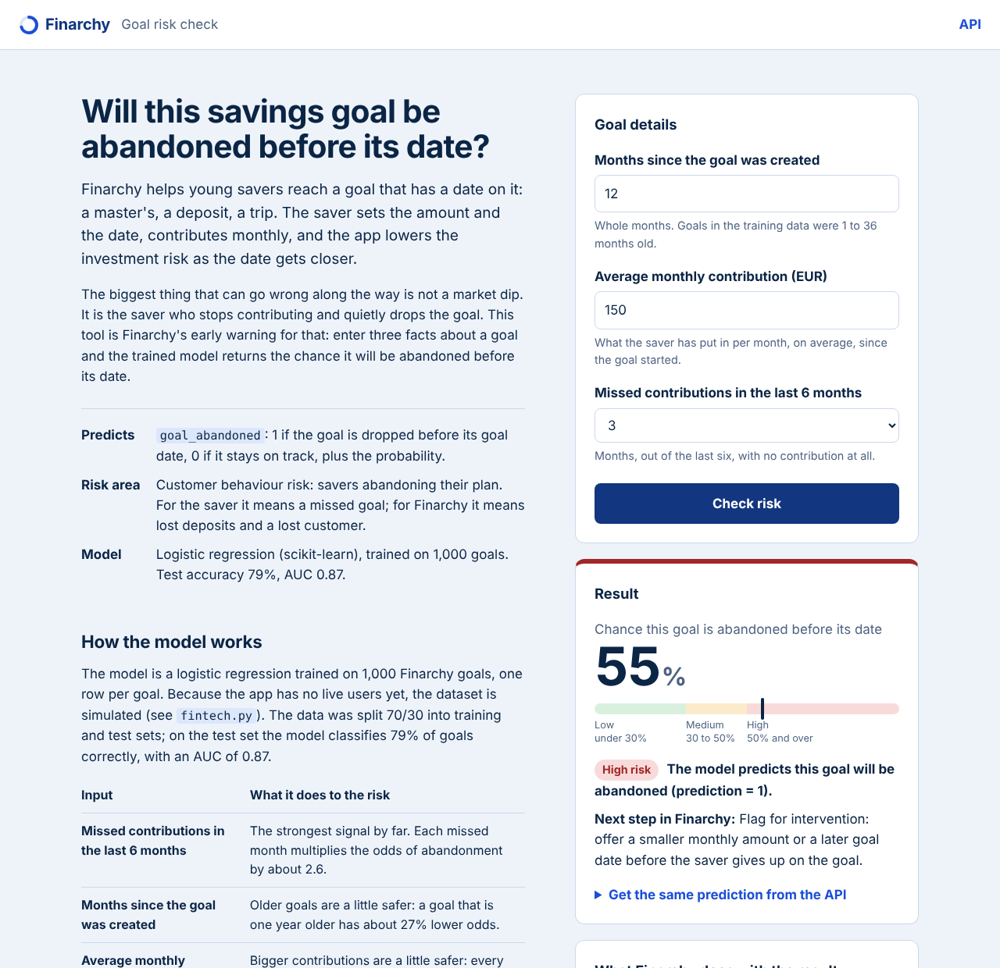

# Finarchy goal risk predictor

A small Flask web application that loads a trained machine-learning model and predicts, live, whether a savings goal on **Finarchy** will be abandoned before its goal date. The prediction is available in two ways:

1. **An HTML front end** where a user enters the three input variables and gets the prediction and its probability.
2. **A JSON API endpoint** (`/api/predict`) that other applications can call.



**Live application:** https://tudbiris.pythonanywhere.com (API: `https://tudbiris.pythonanywhere.com/api/predict`)

## The Fintech idea and the risk being predicted

Finarchy is a goal-date investing app. A saver sets a goal amount and a date (a master's, a deposit, a trip), contributes every month, and the app automatically lowers the investment risk as the date gets closer, so a market drop just before the goal date cannot wipe out the plan.

The risk area covered by this model is **customer behaviour risk: goal abandonment**. The most common way a goal fails is not a market dip but the saver who stops contributing and drops the goal. For the saver that means a missed goal; for Finarchy it means lost deposits and a lost customer.

The model predicts `goal_abandoned`:

| Value | Meaning |
|---|---|
| `1` | The goal is likely to be abandoned before its goal date |
| `0` | The goal is likely to stay on track |

It also returns the probability of abandonment, which Finarchy turns into a risk band with an action inside the app:

| Risk band | Probability of abandonment | What Finarchy does |
|---|---|---|
| `low` | under 30% | No action needed. Standard monthly reminder. |
| `medium` | 30% to under 50% | A nudge before the next contribution date, showing how close the goal already is. |
| `high` | 50% and over (prediction = 1) | Flag for intervention: offer a smaller monthly amount or a later goal date before the saver gives up. |

## The model

`fintech.py` builds the dataset, trains the model and saves it:

- **Algorithm:** logistic regression (`sklearn.linear_model.LogisticRegression`).
- **Data:** 1,000 savings goals, one row per goal, saved in `fintech.xlsx`. The app has no live users yet, so the dataset is simulated with a fixed random seed (42), which makes the training reproducible.
- **Split:** 70% training, 30% test, stratified on the target.
- **Results:** 79% accuracy on both the training and the test set, AUC of 0.87 on the test set.
- **Saved model:** `fintech.joblib` (trained with scikit-learn 1.8.0).

Input variables, in the order the model expects them:

| Variable | Type | Meaning | Range in training data |
|---|---|---|---|
| `months_since_goal_created` | whole number | Months since the saver created the goal | 1 to 36 |
| `avg_monthly_contribution` | number (EUR) | Average amount contributed per month since the goal started | 10 to 500 |
| `missed_contributions_last_6_months` | whole number | Months out of the last six with no contribution at all | 0 to 6 |

What the fitted coefficients say:

| Variable | Coefficient | Plain reading |
|---|---|---|
| `missed_contributions_last_6_months` | +0.94 | Each missed month multiplies the odds of abandonment by about 2.6. By far the strongest signal. |
| `months_since_goal_created` | -0.026 | Older goals are a little safer: one extra year lowers the odds by about 27%. |
| `avg_monthly_contribution` | -0.0049 | Bigger contributions are a little safer: every extra 100 EUR a month lowers the odds by about 39%. |

To retrain the model and regenerate `fintech.xlsx` and `fintech.joblib`:

```bash
python fintech.py
```

## Project structure

```
IMPACT-finarchy-goal-risk/
├── flask_app.py          # Flask app: HTML routes + JSON API
├── fintech.py            # Builds the dataset, trains and saves the model
├── fintech.joblib        # Trained logistic regression model
├── fintech.xlsx          # Dataset used for training (1,000 goals)
├── requirements.txt
├── templates/
│   └── index.html        # HTML front end
├── static/
│   └── style.css
└── docs/
    └── screenshot.png
```

## Run it locally

Requires Python 3.10 or newer.

```bash
git clone https://github.com/tbiris-ieu/IMPACT-finarchy-goal-risk.git
cd IMPACT-finarchy-goal-risk

python -m venv .venv
source .venv/bin/activate        # on Windows: .venv\Scripts\activate
pip install -r requirements.txt

python flask_app.py
```

Then open <http://127.0.0.1:5000> in a browser.

`requirements.txt` pins scikit-learn to 1.8.0, the version the model was saved with. With another scikit-learn version the saved model may load but fail at prediction time (1.6, for example, raises `no attribute 'multi_class'`). `flask_app.py` checks for this on startup and, if needed, retrains the model with `fintech.py` and saves the new `fintech.joblib`; the training is seeded, so the retrained model is identical. You can also do it by hand with `python fintech.py`.

## 1. HTML front end

Route: `GET /` (form) and `POST /predict` (form handler).

The page explains what is being predicted and why it matters for Finarchy, then offers a form with the three input variables. After **Check risk** the page shows:

- the probability that the goal is abandoned before its date, as a percentage and as a marker on a low / medium / high scale;
- the model's prediction (1 = abandoned, 0 = on track) and the risk band;
- the next step Finarchy would take for that goal;
- a warning when an input is outside the range seen in training;
- the same request as a `curl` command and the JSON the API returns for it.

Invalid inputs (for example a negative contribution) are reported on the page with a message that says what to fix.

## 2. API endpoint

### `POST /api/predict`

Receives the three input variables, applies the trained model and returns the prediction as JSON.

- **Request body:** a JSON object with the three variables (`Content-Type: application/json`). Regular form fields (`application/x-www-form-urlencoded`) are accepted too.
- **Response:** `200 OK` with the JSON described below.
- **Errors:** `400 Bad Request` with `{"error": "<what to fix>"}` when a variable is missing or invalid.

| Parameter | Required | Rules |
|---|---|---|
| `months_since_goal_created` | yes | whole number, 0 or more |
| `avg_monthly_contribution` | yes | number, 0 or more (EUR per month) |
| `missed_contributions_last_6_months` | yes | whole number from 0 to 6 |

### `GET /api/predict`

Same endpoint with the variables passed as query-string parameters. Handy for a quick test in the browser:

```
http://127.0.0.1:5000/api/predict?months_since_goal_created=12&avg_monthly_contribution=150&missed_contributions_last_6_months=3
```

### Example request

```bash
curl -X POST http://127.0.0.1:5000/api/predict \
  -H "Content-Type: application/json" \
  -d '{"months_since_goal_created": 12, "avg_monthly_contribution": 150, "missed_contributions_last_6_months": 3}'
```

### Example response

```json
{
  "inputs": {
    "months_since_goal_created": 12,
    "avg_monthly_contribution": 150.0,
    "missed_contributions_last_6_months": 3
  },
  "prediction": 1,
  "prediction_label": "goal_abandoned",
  "probability_abandoned": 0.5511,
  "probability_on_track": 0.4489,
  "risk_level": "high",
  "recommended_action": "Flag for intervention: offer a smaller monthly amount or a later goal date before the saver gives up on the goal.",
  "warnings": []
}
```

| Field | Meaning |
|---|---|
| `inputs` | The values the model was given, after validation |
| `prediction` | `1` = goal abandoned before its date, `0` = on track (the model's 0.5 cut-off) |
| `prediction_label` | `"goal_abandoned"` or `"on_track"` |
| `probability_abandoned` | Probability of class 1, rounded to 4 decimals |
| `probability_on_track` | Probability of class 0 |
| `risk_level` | `"low"`, `"medium"` or `"high"` (see the risk bands above) |
| `recommended_action` | What Finarchy does for a goal in that band |
| `warnings` | Messages when an input is outside the range seen in training; empty list otherwise |

### Example error

```bash
curl "http://127.0.0.1:5000/api/predict?months_since_goal_created=12&avg_monthly_contribution=150&missed_contributions_last_6_months=9"
```

```json
{
  "error": "missed_contributions_last_6_months must be between 0 and 6."
}
```

### Calling the API from Python

```python
import requests

response = requests.post(
    "http://127.0.0.1:5000/api/predict",
    json={
        "months_since_goal_created": 12,
        "avg_monthly_contribution": 150,
        "missed_contributions_last_6_months": 3,
    },
)
result = response.json()
print(result["prediction"], result["probability_abandoned"], result["risk_level"])
# 1 0.5511 high
```

### Calling the API from JavaScript

```javascript
const response = await fetch("http://127.0.0.1:5000/api/predict", {
  method: "POST",
  headers: { "Content-Type": "application/json" },
  body: JSON.stringify({
    months_since_goal_created: 12,
    avg_monthly_contribution: 150,
    missed_contributions_last_6_months: 3,
  }),
});
const result = await response.json();
```

## Deploying on PythonAnywhere

The app is a standard Flask application, so it runs on any WSGI host. These are the steps for a free PythonAnywhere account.

1. **Web tab, "Add a new web app"**, choose **Flask** and the newest Python version offered (3.13 on current accounts). Accept the default path `/home/TudBiris/mysite/flask_app.py`. PythonAnywhere creates a sample app and a WSGI file that already imports `app` from `flask_app`.
2. **Replace the sample app with this repository.** Open a Bash console and run:

   ```bash
   cd ~
   rm -rf mysite
   git clone https://github.com/tbiris-ieu/IMPACT-finarchy-goal-risk.git mysite
   ```

3. **Use the preinstalled packages.** Flask, pandas, numpy, scikit-learn and joblib are already installed on PythonAnywhere, so there is no need for a virtualenv (a full install of these packages would not fit in a free account's disk quota). PythonAnywhere's scikit-learn is usually not 1.8.0, the version the model was saved with. The app handles that on its own: on the first start it notices the saved model cannot be used, retrains it with `fintech.py` (same seed, same model) and saves the new `fintech.joblib`. To do the same by hand, run `python3.13 fintech.py` in `~/mysite`, using the Python version you picked for the web app.

4. **Reload** the web app from the Web tab and open `https://tudbiris.pythonanywhere.com`. If the page does not load or a form submit returns "Internal Server Error", the error log linked on the Web tab shows why.
5. **Test the API** from anywhere:

   ```bash
   curl "https://tudbiris.pythonanywhere.com/api/predict?months_since_goal_created=12&avg_monthly_contribution=150&missed_contributions_last_6_months=3"
   ```

The model file, templates and static files are all located relative to `flask_app.py`, so the app works from any working directory and needs no extra static-file mapping.

## Notes

- The dataset is simulated and the model is a prototype for a class project. It is not financial advice.
- The risk-band threshold and the recommended actions live at the top of `flask_app.py` (`MEDIUM_RISK_FROM`, `RECOMMENDED_ACTION`) and can be changed without touching the model.
